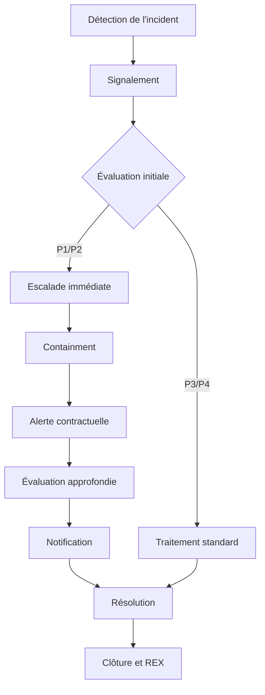

# Plan de Réponse aux Incidents (PRI) - Modèle PME e-Santé

> Ce document est une entrée, pas un audit. Il donne aux responsables de PME une vision claire de ce qu'est un plan de réponse aux incidents aligné ISO 27001:2022, des obligations en jeu et des actions prioritaires.   

> C'est un modèle générique, aligné sur:
> - ISO 27001:2022 (A.5.24 à A.5.28, A.5.30).
> - RGPD (Art. 33-34 : Notification des violations).
> - CSP L. 1111-8-2 : Signalement des incidents significatifs ou graves, applicable aux établissements de santé (à vérifier selon votre statut).
> - CSP  R.1111-11 : Modalités contractuelles de signalement des incidents.
> - NIS2 : Art. 21 (Mesures de gestion des risques et de sécurité des réseaux), Art. 23 (Notification des incidents), applicable à compter de la transposition, état au 19/10/2026 : non encore transposé en France. 

## Objectifs

- Répondre rapidement aux incidents de sécurité grâce à des processus formalisés de réponse aux incidents.
- Respecter les délais applicables (RGPD : 72h ; délais contractuels de vos partenaires ; signalement sectoriel selon votre statut).
- Améliorer en continu la posture de sécurité via des REX (Retours d’Expérience).
- Sensibiliser les employés à la détection et au signalement.

## Comment l’utiliser ?

- Personnalisez les sections (ex : noms, emails, outils).
- Ajoutez/supprimez des playbooks en fonction de vos risques spécifiques (ex. : si vous n'utilisez pas de prestataire de paiement, retirez les playbooks liés).
- Testez le PRI via des exercices (ex : simulation de phishing).
- Réviser le document trimestriellement (ou après chaque incident critique).
- Archiver les anciennes versions dans un dossier /archives/.

---

## **Sommaire**

0. [Personnalisation Rapide](#personnalisation-rapide)
1. [Définitions et Classification](#1-définitions-et-classification)
   - [1.1. Définitions et Classification des Incidents](#11-définitions-et-classification-des-incidents)
   - [1.2. Rôles et Responsabilités](#12-rôles-et-responsabilités)
2. [Canaux de Signalement](#2-canaux-de-signalement)
3. [Procédure Générale de Réponse aux Incidents](#3-procédure-générale-de-réponse-aux-incidents)
   - [3.1. Revue de Direction et Amélioration Continue](#31-revue-de-direction-et-amélioration-continue)
   - [3.2. Processus Global de Réponse aux Incidents](#32-processus-global-de-réponse-aux-incidents)
   - [3.3. Playbooks pour Incidents Courants](#33-playbooks-pour-incidents-courants)
   - [3.4. Revue Trimestrielle](#34-revue-trimestrielle)
   - [3.5. Exercices et Tests](#35-exercices-et-tests)
4. [Historique des Révisions](#4-historique-des-révisions)
5. [Annexes](#5-annexes)
   - [5.1. Tableau des Obligations par Réglementation](#51-tableau-des-obligations-par-réglementation)
   - [5.2. Registre des Incidents](#52-registre-des-incidents)
   - [5.3. Retour sur Expérience (REX)](#53-retour-sur-experience-rex)
   - [5.4. Gabarit de préparation de notification (RGPD art. 33-34)](#54-gabarit-de-préparation-de-notification-rgpd-art-33-34)

----

## Personnalisation Rapide
(À compléter avant utilisation)

| Champ | Votre Valeur |
| --- | --- |
| Nom de l’entreprise | [Entreprise]|
| RSSI | [Nom RSSI] |
| Email RSSI | [Email RSSI] |
| DevOps | Rôle tenu par l’un des développeurs, astreinte en rotation [Nom] |
| DPO | [Nom DPO] |
| CEO | [Nom CEO]  |
| RH | [Nom RH] |
| Email Incidents | [Email incidents] | 
| Ligne Téléphonique | [Numéro] |
| Outil de Logging | [Outil] |
| Outil EDR | [Outil] |
| Outil WAF | [Outil] |
| Fournisseur Cloud | [Fournisseur] |
| Couverture | Couverture hors heures ouvrées : [ex. 24/7 / astreinte légère (relais 30 min) / heures ouvrées uniquement]  |

_Note : une astreinte suppose un cadre formel (programmation individuelle, contrepartie, information des représentants du personnel), à définir selon votre accord collectif ou, à défaut, une décision de l’employeur (Code du travail, art. L3121-9 et suivants)._

#### Qualification du rôle RGPD par traitement

 | Traitement / catégorie de données | Rôle RGPD | Destinataire de l'alerte en cas d'incident | Délai d'alerte |
 | --- | --- | --- | --- |
 | [Ex. données clients B2C] | Responsable de traitement | CNIL si la violation présente un risque pour les droits et libertés (art. 33.1), personnes concernées en plus si risque élevé (art. 34) | 72h dès T0 (CNIL), sans délai indu (personnes)|
 | [Ex. données traitées pour un client] | Sous-traitant | Le client (référent contractuel, cf. R.1111-11 si données de santé hébergées) | Sans délai injustifié (contrat : [délai, ex. 24h]) |
 | [Ex. données partagées avec un partenaire, RGPD art. 26] | Co-responsable | Selon convention (qui notifie quoi) | Selon convention |

_Note : un même incident peut toucher plusieurs traitements, appliquer chaque ligne concernée. Mettre à jour ce tableau à chaque évolution du registre des traitements._

---

## 1. Définitions et Classification

### 1.1. Définitions et Classification des Incidents
(À adapter selon vos risques métiers) 

**Date de détection :** horodatage de la première alerte (automatique SIEM, outil ou manuelle).  
Information d'analyse : elle peut précéder T0 (alerte non vue pendant plusieurs heures : cet écart alimente le KPI « Temps moyen de détection »). 
**T0 : horodatage du constat humain** : violation avérée ou raisonnablement certaine). Point de départ de tous les délais (72h CNIL, résolution, alertes contractuelles).

**Violation de données (art. 4.12) :** destruction, perte, altération, divulgation non autorisée ou accès non autorisé à des données personnelles. Un ransomware sans exfiltration est une violation (perte de disponibilité), l'évaluation art. 34 s'applique.

| Niveau | Sévérité | Description | Exemples | Délai de Réaction | Délai de Notification | Responsable |
| --- | --- | --- | --- | --- | --- | --- |
| P1 | 🔴 Critique | Violation avérée de données sensibles (PII, santé) ou impact opérationnel majeur. | Ransomware, fuite de données médicales, accès non autorisé à un système critique. | < 1h en heures ouvrées, hors heures : selon votre couverture (personnalisation) | Échéance légale : 72h à compter de T0 (si responsable de traitement et risque, art. 33.1). Cible interne de préparation : dossier de notification prêt < 24h. Délais contractuels : selon contrat [voir aussi 5.1](#51-tableau-des-obligations-par-réglementation)| RSSI |
| P2 | 🟠 Élevée | Incident avec impact potentiel sur les données ou les services. | Phishing réussi, vulnérabilité critique non patchée, tentative de fraude. | < 4h en heures ouvrées, hors heures : selon votre couverture (personnalisation)| 72h si violation de données personnelles et risque (art. 33.1). | RSSI + DevOps |
| P3 | 🟡 Modérée | Incident avec impact limité ou contrôlé. | Accès non autorisé à un système non critique, malware non propagé. | < 24h | Aucune (sauf si données personnelles) | DevOps |
| P4 | 🟢 Faible | Incident sans impact direct sur les données ou les services. | Fausse alerte, tentative de force brute bloquée. | < 72h | Aucune | DevOps |

### 1.2. Rôles et Responsabilités
(À adapter selon votre organigramme)

| Rôle | Nom | Email | Téléphone | Responsabilités | Délai de Réaction |
| --- | --- | --- | --- | --- | --- |
| Responsable Incidents (RI) | [RSSI] | [Email RSSI] | [Téléphone] | Coordonner la réponse, escalader vers la direction, valider la clôture. | Immédiat (P1/P2) |
| Responsable Technique (RT) | [DevOps] | [Email DevOps] | [Téléphone] | Analyser l’incident, appliquer les correctifs techniques. | < 1h (P1), < 4h (P2) |
| Responsable Données Privées (DPO) | [DPO] | [Email DPO] | [Téléphone] | Assister le responsable de traitement dans la qualification du risque et la préparation des notifications, point de contact auprès de la CNIL (art. 39). Ne notifie pas en son nom. |Immédiat (P1/P2) |
| Responsable RH | [RH] | [Email RH] | [Téléphone] | Sensibilisation des employés, accompagnement en cas d'incident lié à une erreur humaine (approche non-blâme). Les suites disciplinaires relèvent d'une politique RH distincte.  | Immédiat (P1/P2) |
| Direction | [CEO] | [Email CEO] | [Téléphone] | Valider les décisions stratégiques (ex : paiement d’une rançon, arrêt d’un service). | < 1h (P1) |
| Équipes Métiers | Tous les employés | - | - | Signaler les incidents via les canaux dédiés (Section 2). | Immédiat |

_Note :_
_- Pour une PME de 15 personnes, un même individu peut cumuler plusieurs rôles._
_- Documenter les absences : Désigner un remplaçant pour chaque rôle (ex : DevOps remplace le RSSI en son absence)._

**Gouvernance de la notification (RGPD art. 33-34)**  
- Décide : le responsable de traitement (en PME : le CEO, ou le dirigeant désigné en personnalisation).  
  - Décision de notifier ou non (art. 33.1 : notification requise si la violation présente un risque pour les droits et libertés), datée et motivée au registre.  
- Prépare : le DPO (qualification du risque, gabarit annexe 5.4). Le DPO conseille, il ne décide pas.  
- Dépose : le DPO au nom du responsable de traitement, en vertu d'une délégation écrite (document daté, signé, archivé, à établir à l'adoption du plan). Sans délégation, le dépôt revient au responsable de traitement lui-même.  
- Preuve : récapitulatif de dépôt du téléservice CNIL + copie de la décision (notifiée / non notifiée) au registre.  

----

## 2. Canaux de Signalement
(À adapter selon vos outils)

| Canal | Utilisation | Public Cible | Délai de Réaction | Exemple | Lien/Contact |
| --- | --- | --- | --- | --- | --- |
| Email sécurisé | Signalement d’incidents non urgents. | Tous les employés | Immédiat | Email de phishing reçu. | [incident@votre-entreprise.fr](mailto:incident@votre-entreprise.fr) |
| Formulaire Web | Signalement simple et guidé. | Tous les employés | Immédiat | Comportement suspect observé. | [https://votre-entreprise.fr/incident]  |
| Ligne téléphonique | Urgences (ex : ransomware, fuite de données), disponibilité selon votre couverture [24/7 / astreinte / heures ouvrées]. | Tous les employés | Immédiat | Appel en cas d’attaque en cours. | +33 X XX XX XX XX |
| Ex. Slack/Teams | Alertes techniques automatiques. | Équipe technique | Immédiat | Alerte depuis [Outil ou SIEM]. | Incidents (canal dédié) |
| Bouton "Signaler" | Intégré dans les outils métiers. | Tous les employés | Immédiat | Bouton dans l’intranet. | À configurer dans vos outils |

**Bonnes Pratiques :**
- Afficher les canaux dans un endroit visible (ex : intranet, signature email).
- Former les employés : 1 session annuelle + rappel trimestriel.
- Garantir la non-représaille : aucun blâme pour un signalement de bonne foi, le traitement du signalement est confidentiel (les canaux email/formulaire ne sont pas forcément anonymes).

-----

## 3. Procédure Générale de Réponse aux Incidents
(À adapter selon vos processus internes)

### 3.1. Revue de Direction et Amélioration Continue
(Gouvernance – ISO 27001:2022, clause 9.3)  
**KPIs de Suivi** à adapter selon vos objectifs 

| Indicateur | Cible | Fréquence | Responsable | Source | YYYY (Objectif) | YYYY (Réel) |
| --- | --- | --- | --- | --- | --- | --- |
| Temps moyen de détection (P1) | < 1h | Mensuel | RI | _Ex. Outil Graylog/Wazuh_ | < 1h | [Valeur] |
| Temps moyen de résolution (P1) | < 24h | Mensuel | RI | Registre des incidents | < 24h | [Valeur] |
| % d’incidents notifiés dans les délais | 100% | Trimestriel | DPO | Registre des incidents | 100% | [Valeur] |
| Nombre d’incidents P1/P2 | ≤ 1/mois | Trimestriel | RI | Registre des incidents | ≤ 12/an | [Valeur] |
| % de REX documentés sous 72h (P1) | 100% | Trimestriel | RI | Dossier /incidents/ | 100% | [Valeur] |

### 3.2. Processus Global de Réponse aux Incidents
(À adapter selon vos processus internes, votre contexte et les risques identifés)

**Étapes Détaillées**

| Étape | Description | Responsable | Délai | Outils/Preuves |
| --- | --- | --- | --- | --- |
| 1. Détection | Détection automatique (outils) ou manuelle (employés). | Tous | Immédiat | _Ex. Graylog, Wazuh, Emails, Alertes SIEM_ |
| 2. Signalement | Signalement via les canaux dédiés (email, formulaire, téléphone). | Employés | Immédiat | incident@votre-entreprise.fr, Formulaire Web, Ligne [selon votre couverture] |
| 3. Évaluation initiale | Retrouver le rôle RGPD des traitements impactés dans le tableau de personnalisation: qualifier seulement si le traitement n'y figure pas + Classer l’incident selon la sévérité (P1 à P4). | RI | < 15 min | Matrice de classification (Section 1.1), tableau de qualification (personnalisation) |
| 4. Escalade | Notifier les responsables selon le niveau de sévérité. | RI | < 1h (P1), < 4h (P2) | Slack, Email, Téléphone |
| 5. Containment | Limiter l’impact de l’incident. | RT | < 1h (P1), < 4h (P2) | Firewall, Isolation réseau, Désactivation de comptes |
| 6. Alerte contractuelle | Informer clients/partenaires selon le tableau de personnalisation (délais contractuels). Ne dépend pas de la qualification du rôle RGPD. | RI | Selon contrats, cible interne < 4h | Email horodaté | 
| 7. Évaluation approfondie | Analyser la cause racine et l’impact. | RT + RI | < 4h (P1), < 24h (P2) | Logs, Rapports techniques |
| 8. Notification CNIL | Si rôle = responsable de traitement et risque pour les droits et libertés (art. 33.1), gouvernance : cf. §1.2. | Voir [gouvernance de la notification](#12-rôles-et-responsabilités) | 72h dès T0 (phasée possible) | Gabarit annexe 5.4, téléservice CNIL, preuve = récapitulatif de dépôt |
| 9. Résolution | Appliquer les correctifs et restaurer les services. | RT | < 24h (P1), < 72h (P2) | Rapports de résolution |
| 10. Clôture et REX | Documenter l’incident et organiser un REX. | RI | < 72h (P1), < 1 semaine (P2) | Registre des incidents, Template REX |

**Processus d’Escalade Standardisé**
(Pour s’assurer que les incidents graves sont rapidement signalés à la direction et aux régulateurs)

| Niveau de Sévérité | Escalade Interne | Escalade Externe | Délai | Responsable |
| --- | --- | --- | --- | --- |
| P1 (Critique) | RI → Direction → Tous les responsables | Selon rôle qualifié : CNIL (Responsable de Traitement) sous 72h | < 1h (interne), cible de préparation du dossier : < 24h, échéance légale : 72h dès T0 | RI + DPO |
| P2 (Élevée) | RI → RT → DPO | CNIL si violation de données personnelles et risque (art. 33.1) | < 4h (interne), échéance légale 72h dès T0 | RI + DPO |
| P3 (Modérée) | RI → RT | Aucune (sauf si données personnelles) | < 24h (interne) | RI |
| P4 (Faible) | RT | Aucune | < 72h (interne) | RT |

**Qualification du rôle RGPD**
Le rôle de chaque traitement est qualifié à l'adoption, cf. tableau « Qualification du rôle RGPD par traitement » [Personnalisation rapide](#personnalisation-rapide). À l'incident, on consulte le tableau, on ne redécide pas.
(a) responsable de traitement → notification CNIL sous 72h dès T0 si risque (art. 33.1), phasage éventuel,
(b) co-responsable de traitement (si pertinent) → notification selon convention,
(c) sous-traitant → alerte du responsable de traitement, sans délai injustifié (alerte au responsable de traitement fait naître le T0 de ce dernier. Votre propre horloge est celle de l'alerte (sans délai injustifié), pas celle des 72h CNIL)  
Toute violation est documentée, notifiée ou non (art. 33.5).

### 3.3. Playbooks pour Incidents Courants
(À adapter selon vos risques spécifiques – Supprimez/ajoutez des playbooks)
_Note : PTR (Plan de Traitement des Risques) = votre document de gestion des risques. Si vous n'en disposez pas encore, remplacez les références [ID risque PTR] par votre registre de risques, ou supprimez la colonne ; elle redevient pertinente dès que vous formalisez un PTR (cf. ISO 27001:2022, A.8.8)._

#### Playbook 1 : Ransomware
Contexte : Détection d’un ransomware (ex : WannaCry, LockBit).

**Important :**
- Position par défaut : ne pas payer (recommandation ANSSI).
- Risques : Pas de garantie de récupération des données, financement du crime.
- Décision : Validée par la direction (CEO). Toute décision contraire est une exception documentée, avec analyse tracée et, si cyber-assurance, accord préalable de l'assureur.

| Étape | Action | Responsable | Outils | Délai | Preuves |
| --- | --- | --- | --- | --- | --- |
| 1 | Isoler les systèmes infectés | RT | *Ex. Wazuh, Firewall* | < 15 min | Logs Wazuh |
| 2 | Identifier la souche | RT | *Ex. VirusTotal (recherche par hash — voir note), NoMoreRansom* | < 1h | Capture d'écran |
| 3a | Alerte contractuelle : informer clients/partenaires selon le tableau de personnalisation (délais contractuels) | RI | Email sécurisé | Cible interne < 4h ; les délais contractuels se lisent dans chaque contrat | Email horodaté envoyé |
| 3b | Notification CNIL : si rôle = responsable de traitement et risque pour les droits et libertés (art. 33.1) — décision datée et motivée au registre | Décide = Responsable de traitement ; prépare/dépose = DPO (délégation écrite) | Téléservice CNIL + Annexe 5.4 | Échéance légale : 72h dès T0 (notification phasée possible) | Récapitulatif de dépôt |
| 3c | Signalement sectoriel si applicable à votre statut (ex. CSP art. L.1111-8-2, établissements de santé — vérifier votre qualification) | RI | Email sécurisé | Selon statut | Email horodaté |
| 3d | Évaluer l'obligation envers les personnes concernées (art. 34), même sans exfiltration avérée (perte de disponibilité = violation, art. 4.12), cf. Playbook 2, étape 4 | Décide = Responsable de traitement, prépare = DPO | Cf. [Playbook 2](#playbook-2--fuite-de-données-piisanté) | Sans délai indu après décision| Registre des incidents |
| 4 | Préserver les preuves (images disques, exports logs, chaîne de conservation — A.5.28) | RT | [Outils forensique — ex : Velociraptor] | Avant toute restauration | Preuves horodatées, chaîne de conservation |
| 5 | Restaurer depuis sauvegarde | RT | *Ex. Sauvegardes (A.8.13)* | < 24h | Logs de restauration |
| 6 | Analyser la cause racine | RT | Logs, REX | < 72h | Rapport d'analyse |
| 7 | Mettre à jour les contrôles | RI | PTR (A.8.7, A.8.8) | < 1 semaine | Mise à jour du PTR |
| 8 | Déposer plainte | Direction | Selon procédure de plainte | Selon procédure | Récépissé plainte |
| 9 | Déclarer l'incident à votre assureur cyber | Direction | Selon procédure assureur | Souvent exigé sans délai — peut conditionner la prise en charge | Déclaration horodatée |

_Note - Etape 2 : Privilégier la recherche par hash / URL sans dépôt d'échantillon. Ne jamais déposer un fichier ou un email contenant des données personnelles ou de santé : tout dépôt, même en compte privé, devient partagé. Si l'analyse du fichier est nécessaire : environnement d'analyse isolé interne._

#### Playbook 2 : Fuite de Données (PII/Santé)
Contexte : Fuite avérée de données personnelles ou de santé.

**A noter :** se référer à procédure des incidents et notifications RGPD si existant.

| Étape | Action | Responsable | Outils | Délai | Preuves |
| --- | --- | --- | --- | --- | --- |
| 1 | Confirmer la fuite (logs centralisés, supervision) | RT | *Ex. Graylog, Wazuh* | < 1h | Logs |
| 2 | Identifier les données exposées | RT + DPO | Registre des traitements | < 2h | Liste des données |
| 3a | Alerte contractuelle : clients/partenaires selon le tableau de personnalisation (sous-traitant : sans délai injustifié, art. 33.2 ; R.1111-11 si hébergement de données de santé) | RI | Email sécurisé (référent contractuel) | Cible interne < 24h ; délais contractuels selon contrat | Email horodaté |
| 3b | Notification CNIL : si rôle = responsable de traitement et risque pour les droits et libertés (art. 33.1) — décision datée et motivée au registre | Décide = Responsable de traitement ; prépare/dépose = DPO (délégation écrite) | [Téléservice CNIL](https://www.cnil.fr/fr/services-en-ligne/notifier-une-violation-de-donnees-personnelles) + Annexe 5.4 | Échéance légale : 72h dès T0 (notification phasée possible) | Récapitulatif de dépôt |
| 3c | Signalement sectoriel si applicable à votre statut (ex. CSP art. L.1111-8-2, établissements de santé — vérifier votre qualification) | RI | Email sécurisé | Selon statut | Email horodaté |
| 4 | Évaluer le risque **pour les droits et libertés des personnes** (impact sur les personnes, comme dans l'AIPD — pas l'impact business ; grille 3×3). Si risque élevé : informer les personnes (art. 34). Sinon : documenter l'analyse au registre (décision tracée, art. 33.5) | Décide = Responsable de traitement ; prépare = DPO | Email sécurisé | Sans délai indu après la décision | Email envoyé, registre des incidents |
| 5 | Corriger la vulnérabilité | RT | Patch, A.8.26 | < 48h | Logs de correctif |
| 6 | REX + Mise à jour du PTR | RI | Registre | < 1 semaine | Compte-rendu REX |

#### Playbook 3 : Phishing Réussi
Contexte : Un employé a cliqué sur un lien malveillant.

| Étape | Action | Responsable | Outils | Délai | Preuves |
| --- | --- | --- | --- | --- | --- |
| 1 | Bloquer l’accès du compte compromis | RT | [Annuaire d'identité — ex : annuaire LDAP, IdP] + MFA | < 30 min | Logs annuaire d'identité  |
| 2 | Réinitialiser les mots de passe | RT | [Procédure de réinitialisation] | < 1h | Logs de réinitialisation |
| 3 | Analyser l’email malveillant | RT | [Analyse d'échantillons, ex : VirusTotal ]| < 2h | Rapport d'analyse |
| 4 | Si données personnelles compromises : déclencher la qualification et l'évaluation art. 33/34 (cf. [Playbook 2](#playbook-2--fuite-de-données-piisanté), étapes 3-4) | RI + DPO  | Registre des traitements + tableau de personnalisation | Dès confirmation | Registre des incidents |
| 5 | Sensibiliser l’employé concerné | RH | Formation ciblée | < 24h | Email de formation |
| 6 | Mettre à jour les filtres anti-phishing | RT | A.8.7 | < 48h | Logs de mise à jour |

_Note - Etape 3 : Privilégier la recherche par hash / URL sans dépôt d'échantillon. Ne jamais déposer un fichier ou un email contenant des données personnelles ou de santé : tout dépôt, même en compte privé, devient partagé. Si l'analyse du fichier est nécessaire : environnement d'analyse isolé interne._ 

### 3.4. Revue Trimestrielle

A adapter aux documents de l'entreprise: Documentée dans PSSI section 3.

Livrable : PV de revue trimestrielle.

### 3.5. Exercices et Tests
(Préparation - ISO 27001:2022, A.5.24 planification et préparation, A.5.26 réponse aux incidents. Les exercices de continuité/PCA relèvent de A.5.30)

**Bonnes Pratiques :**  
- Documenter les résultats dans /exercices/{ANNEE}/.  
- Améliorer les playbooks après chaque exercice.  

| Type d’Exercice | Fréquence | Participants | Scénario | Objectif | Prochaine Date | Responsable |
| --- | --- | --- | --- | --- | --- | --- |
| Test de Phishing | Trimestriel | Tous les employés | Campagne simulée (ex : faux email CNIL) | Sensibilisation + Détection | DD-MM-YYYY | RH + DPO |
| Simulation Ransomware | Semestriel | RI + RT + Direction | Attaque simulée (ex : fichier chiffré) | Test des playbooks P1 | DD-MM-YYYY  | RI |
| Exercice sur Table | Annuel | RI + RT + DPO + Direction | Fuite de données (PII) | Validation des procédures P1/P2 | DD-MM-YYYY  | RI |
| Test de Notification RGPD | Annuel | DPO + Direction | Violation simulée (ex : fuite de données) | Respect des délais (72h) | DD-MM-YYYY  | DPO |
| Test de Sauvegarde | Trimestriel | RT | Restauration depuis sauvegarde | Vérification de l’intégrité (A.8.13) | DD-MM-YYYY  | RT |

-----

## 4. Historique des Révisions
(À mettre à jour après chaque modification : historique de votre instance du plan. _Le versioning du modèle générique figure en pied de page._)

| Version | Date | Auteur | Modifications | Approbation |
| --- | --- | --- | --- | --- |
| 1.0 | DD-MM-YYYY  | [Votre Nom] | Création initiale du PRI. | [CEO] |
| 1.1 | DD-MM-YYYY  | [Nom] | [Ex : Ajout du playbook "Indisponibilité d’un service critique"]. | [CEO] |

----

## 5. Annexes

Documentation liée à créer séparément, mettre à jour et archivée pour anciennes versions.

### 5.1. Tableau des Obligations par Réglementation

> **Qualification NIS2 : à lire avant de renseigner les lignes NIS2 de ce tableau.**
> NIS2 ne s'applique qu'aux entités *essentielles* ou *importantes* qualifiées (directive (UE) 2022/2555, annexes I et II).
> - **Entité qualifiée** : les lignes art. 21 et 23 s'appliqueront à compter de la transposition de la directive en droit national (état au 19/10/2026 : transposition non publiée, à vérifier à chaque revue trimestrielle).
> - **Entité non qualifiée mais fournisseur d'une entité assujettie** (ex. établissement de santé) : NIS2 s'impose *indirectement* via les clauses contractuelles du client (supply chain) - reportez ces exigences dans les lignes « contractuel » plutôt que dans les lignes NIS2.
> Sanctions : fixées par le droit national de transposition, dans la limite d'un plancher de plafond défini à l'art. 34 de la directive (au moins 10 M€ ou 2 % du CA mondial annuel pour les entités essentielles, au moins 7 M€ ou 1,4 % pour les importantes). Tant que la transposition n'est pas publiée, ces montants sont indicatifs.
> - Ne renseignez aucun statut NIS2 avant d'avoir **documenté votre qualification** (délais, séquence de notification) - cf. [Guide ressource correspondance NIS2 du projet](./nis2_correspondances_ISO27001.md).
>
> **Aucun statut n'est pré-rempli.** Chaque statut est le résultat de votre évaluation, datée (format DD-MM-YYYY) et appuyée sur une preuve. Un statut sans preuve datée n'a pas de valeur.

**Mode d'emploi :**  
- Adapter ce tableau à vos obligations réglementaires et à votre documentation existante.
- Mettre à jour ce tableau trimestriellement ou après chaque changement réglementaire.
- Cocher les actions réalisées : voir Légende. Valeur par défaut : [À évaluer - DD-MM-YYYY].
- Ajouter des lignes pour les nouvelles obligations (ex : nouveau règlement européen).
- Lier chaque contrainte à votre PTR ou PRI (ex : RGPD Art. 33 → ID Risque).
- Archiver les anciennes versions : Conservez un historique des versions dans un dossier type /archives/contraintes-reglementaires/.

**Légende :**
| Symbole | Signification | Action Recommandée |
| --- | --- | --- |
| ✅ | Conforme | Aucune action requise. |
| 🟠 | Partiellement conforme | Vérifier et compléter. |
| ❌ | Non conforme | Priorité absolue : Corriger immédiatement. |

|  Réglementation | Article/Référence | Obligation | Périmètre | Délai | Sanction (Max) | Responsable | Actions à Mettre en Œuvre | Preuves | Lien avec le PTR/PRI | Statut (évalué le DD-MM-YYYY) |
| --- | --- | --- | --- | --- | --- | --- | --- | --- | --- | --- |
| RGPD | Art. 5 | Principes de base (licéité, finalité, minimisation) | Toutes les données personnelles | Permanent | 4% du CA ou 20M€ | DPO (conseille) | Vérifier la conformité des traitements. | Registre des traitements | [ID risque PTR] | [À évaluer - DD-MM-YYYY] |
| RGPD | Art. 24 | Responsabilité du responsable de traitement | Toutes les données personnelles | Permanent | 4% du CA ou 20M€ | Responsable de traitement (DPO conseille) | Mettre en place des mesures techniques et organisationnelles. | PSSI, SoA | [ID risque PTR] | [À évaluer - DD-MM-YYYY] |
| RGPD | Art. 28 | Contrats avec les sous-traitants | Tous les fournisseurs (ex : hébergeur, prestataire de paiement) | Permanent | 4% du CA ou 20M€ | [Référent juridique, en PME : CEO ou DPO] + DPO  | Vérifier que tous les contrats incluent les clauses RGPD Art. 28. | [Contrats signés] | [ID risque PTR] | [À évaluer - DD-MM-YYYY] |
| RGPD | Art. 30 | Registre des traitements | Toutes les données personnelles | Permanent | 4% du CA ou 20M€ | Responsable de traitement (DPO conseille) | Maintenir à jour le registre des traitements. | [Registre des traitements] | [ID risque PTR] | [À évaluer - DD-MM-YYYY] |
| RGPD | Art. 32 | Sécurité des traitements | Toutes les données personnelles | Permanent | 4% du CA ou 20M€ | RSSI | Mettre en place des mesures de sécurité (chiffrement, pseudonymisation). | SoA, PTR | [ID risque PTR] | [À évaluer - DD-MM-YYYY] |
| RGPD | Art. 33 | Notification des violations | Violation de données personnelles | 72h max à compter de la prise de connaissance (T0) | 4% du CA ou 20M€ | Responsable de traitement (DPO prépare et dépose, point de contact CNIL art. 39) | *Responsable de traitement* : notifier la CNIL sous 72h à compter de T0 si risque pour les droits et libertés (art. 33.1), notification possible en plusieurs phases. *Sous-traitant* : alerter son responsable de traitement sans délai injustifié (art. 33.2) - pas de notification CNIL. Retrouver le rôle dans le tableau de personnalisation ([PRI §3.2](#32-processus-global-de-réponse-aux-incidents), étape 3). | Téléservice CNIL | [ID risque PTR], PRI §3.2 étape 8 | [À évaluer - DD-MM-YYYY] |
| RGPD | Art. 34 | Information des personnes concernées | Violation présentant un risque élevé pour les droits et libertés | Sans délai indu (après évaluation du risque) | 4% du CA ou 20M€ | Responsable de traitement (DPO prépare) | Évaluer le risque pour les droits et libertés (grille de cotation). Si risque élevé : informer les personnes sans délai indu. Sinon : documenter l'analyse au registre (décision tracée). | Template RGPD, analyse de risque | [ID risque PTR], PRI §3.3 playbook 2 | [À évaluer - DD-MM-YYYY] |
| RGPD | Art. 35 | AIPD (Analyse d'Impact) | Traitements à haut risque (ex : données de santé) | Avant le traitement | 4% du CA ou 20M€ | Responsable de traitement (DPO conseille) | Réaliser une AIPD pour les traitements critiques ; réexaminer après incident ou changement majeur. | [AIPD] | [ID risque PTR] | [À évaluer - DD-MM-YYYY] |
| CSP | L.1111-8, R.1111-8 et s. | Certification HDS pour l'hébergement de données de santé | Données de santé | Permanent | Sanctions pénales et administratives | RSSI | Vérifier que votre hébergeur est certifié HDS (périmètre d'activités et localisation couverts par le certificat). | [Certificat HDS de l'hébergeur] | [ID risque PTR] | [À évaluer - DD-MM-YYYY] |
| CSP | L.1111-8-2 | Signalement des incidents de sécurité des systèmes d'information graves ou significatifs | Établissements de santé (santé/ médico-social selon le texte), vérifier votre qualification : ligne N.A. si votre statut n'est pas concerné | Sans délai | [À vérifier, pas de sanction spécifique identifiée au texte] | RI | Si applicable à votre statut : ajouter l'étape « signalement sectoriel » aux playbooks P1/P2 (étape 3c). Destinataire à vérifier selon votre statut. Sinon : tracer la vérification de non-applicabilité. | Email de signalement horodaté ou note de non-applicabilité datée | [ID risque PTR], PRI §3.3 (étape 3c) | [À évaluer - DD-MM-YYYY] |
| CSP | R.1111-11 | Impose au contrat d'hébergement (hébergeur ↔ client, et prestataire intermédiaire le cas échéant) des clauses sur les modalités de signalement au responsable de traitement et la mention du référent contractuel incidents. | Contrat d'hébergement de données de santé | Permanent | Sanctions à vérifier : pas de sanction spécifique identifiée dans le texte | RSSI | Vérifier que le contrat avec chaque client précise le référent contractuel à contacter pour les incidents impactant les données hébergées, et les modalités de signalement des violations. | [Contrats avec clauses R.1111-11] | [ID risque PTR], PRI §3.2 étape 6 | [À évaluer - DD-MM-YYYY] |
| HDS | Référentiel de certification HDS (ANS) | Sécurité physique et logique de l'hébergement | Données de santé | Permanent | Sanctions administratives | RSSI | Vérifier les accès physiques et logiques de l'hébergeur (audits, exigences du référentiel applicable à votre version). | [Audit hébergeur] | [ID risque PTR] | [À évaluer - DD-MM-YYYY] |
| NIS2 | Art. 21 | Gestion des risques et mesures de sécurité | Systèmes critiques - **uniquement si entité qualifiée** (cf. encadré Qualification NIS2) | Permanent | Si applicable : sanctions fixées par le droit national de transposition, dans la limite d'un plancher de plafond défini à l'art. 34 de la directive (au moins 10 M€ ou 2 % du CA mondial annuel pour les essentielles, au moins 7 M€ ou 1,4 % pour les importantes) - indicatifs tant que la transposition n'est pas publiée | RSSI | Si qualifié : gestion des risques formalisée (PTR) et contrôles de sécurité (ex : A.8.20, A.8.21). Si non qualifié : relever et traiter les exigences remontant des clients assujettis (contractuel). | PTR, SoA | [ID risque PTR] | [À évaluer - DD-MM-YYYY] |
| NIS2 | Art. 21 | Gestion des vulnérabilités | Tous les systèmes - **si entité qualifiée** | Permanent | Idem ligne précédente | DevOps | Corriger les vulnérabilités selon votre politique (délais par criticité, ex : 30 jours pour les critiques). | [Rapport de vulnérabilités] | [ID risque PTR] | [À évaluer - DD-MM-YYYY] |
| NIS2 | Art. 23 | Obligations d'information en cas d'incident | Tous les systèmes - **si entité qualifiée** | Alerte précoce < 24h ; notification d'incident < 72h ; rapport final < 1 mois | Idem art. 21 | RSSI | Si qualifié : intégrer la séquence 24h/72h/1 mois au PRI (classification P1 et escalade externe). Si non qualifié : relever les délais d'information contractuels des clients assujettis (playbooks, étape « notification tierce »). | PRI, registre des incidents | [ID risque PTR], PRI §3.2 | [À évaluer - DD-MM-YYYY] |
| ISO 27001:2022 | A.5.1 | Politiques de sécurité | Tous les actifs | Permanent | Non-conformité certification | RSSI | Maintenir une PSSI à jour. | [PSSI] | [ID risque PTR] | [À évaluer - DD-MM-YYYY] |
| ISO 27001:2022 | A.5.15 | Contrôle d'accès | Tous les actifs | Permanent | Non-conformité certification | RSSI | Appliquer une matrice RBAC ; revue périodique des droits. | [Matrice RBAC] | [ID risque PTR] | [À évaluer - DD-MM-YYYY] |
| ISO 27001:2022 | A.8.15 | Enregistrement des activités | Tous les systèmes | Permanent | Non-conformité certification | DevOps | Conserver les logs selon votre politique de rétention (à définir, ex : 1 an glissant). | [Logs centralisés] | [ID risque PTR] | [À évaluer - DD-MM-YYYY] |
| ISO 27001:2022 | A.8.16 | Activités de surveillance | Tous les systèmes | Permanent | Non-conformité certification | DevOps | Surveiller les activités (ex. SIEM / logs centralisés, ex : Graylog + Wazuh). | [Logs centralisés] | [ID risque PTR] | [À évaluer - DD-MM-YYYY] |
| ISO 27001:2022 | A.8.20 | Sécurité des réseaux | Réseaux internes | Permanent | Non-conformité certification | RSSI | Segmenter les réseaux (ex : DMZ pour les APIs exposées). | [Schéma réseau] | [ID risque PTR] | [À évaluer - DD-MM-YYYY] |
| ISO 27001:2022 | A.8.29 | Tests de sécurité | Applications critiques | Avant mise en production + revue périodique | Non-conformité certification | DevOps | Réaliser des tests de pénétration réguliers (fréquence selon criticité). | [Rapport de tests] | [ID risque PTR] | [À évaluer - DD-MM-YYYY] |

----

### 5.2. Registre des incidents
(Traçabilité complète - ISO 27001:2022, A.5.24 à A.5.28 - gestion des incidents, la surveillance au sens A.8.16 alimente le registre mais n'en est pas l'exigence)
Toute violation est documentée, notifiée ou non (art. 33.5) : le présent registre en est le support.

**Instructions :**  
- Mettre à jour ce tableau après chaque incident.  
- Archiver les incidents clôturés dans /incidents/{ANNÉE}/.  
- Lier chaque incident à un risque du PTR (ex : INC-AAA-001 → [ID risque PTR, ex : R-DON-XX]).  
_Note : tableau ci-dessous avec exemple illustratif, données à supprimer lors de l'adoption._

| **ID** | **Date** | **Type** | **Sévérité** | **Actif/Processus** | **Statut** | **RI** | **RT** | **DPO** | **Date Détection** | **T0 (Prise de Connaissance)** | **Décision de notifier (O/N + justification, art. 33.1)** | **Date Résolution** | **Délai de Résolution (depuis T0)** | **Date de notification effective (destinataire)** | **Lien REX** | **Lien PTR** |
| --- | --- | --- | --- | --- | --- | --- | --- | --- | --- | --- | --- | --- | --- | --- | --- | --- |
| INC-AAAA-XX | JJ/MM/AAAA | Ransomware | 🔴 P1 | [Actif critique, ex : serveur de production (registre des traitements D-XX)] | Clôturé | [Nom RI] | [Nom RT] | [Nom DPO] | JJ/MM/AAAA 14:15 | JJ/MM/AAAA 14:30 | Oui — risque pour les droits et libertés (art. 33.1) | JJ/MM/AAAA+1 10:00 | 19h30 | Notifié le JJ/MM/AAAA à HHhMM — [CNIL / client selon rôle] | [REX-INC-AAAA-XX] | [ID risque PTR, ex : R-DON-XX] |
| INC-AAAA-YY | JJ/MM/AAAA | Phishing | 🟠 P2 | Messagerie [ID actif, ex : T-XX] | Clôturé | [Nom RI] | [Nom RT] | - | JJ/MM/AAAA 09:00 | JJ/MM/AAAA 09:15 | Non — pas de risque démontré ; violation documentée (art. 33.5) | JJ/MM/AAAA 11:00 | 1h45 | Aucune | [REX-INC-AAAA-YY] | [ID risque PTR, ex : R-DON-XX] |
| INC-AAAA-ZZ | JJ/MM/AAAA | Accès non autorisé | 🟡 P3 | [Outil interne non critique, ex : réservation de salles] | Clôturé | [Nom RI] | [Nom RT] | - | JJ/MM/AAAA 10:20 | JJ/MM/AAAA 11:20 | Non - pas de données personnelles | JJ/MM/AAAA 16:45 | 5h25 | Aucune | [REX-INC-AAAA-ZZ] | [ID risque PTR, ex : R-XX-XX] |

-----

### 5.3. Retour sur Experience (REX)
(Amélioration continue – ISO 27001:2022, A.5.27)
_Note : tableau ci-dessous avec exemple illustratif, données à supprimer lors de l'adoption._

**Instructions :** À remplir après chaque incident P1/P2, ou mensuellement pour les P3/P4.

---
### **REX – Incident [ID]**
**Date de l’incident** : [JJ/MM/AAAA]
**Niveau** : [P1/P2/P3/P4]
**Type** : [Ransomware/Fuite de données/Phishing/Autre]
**Responsable REX** : [Nom]

#### **1. Description de l’Incident**
- **Date/Heure de détection** : [Heure]
- **Date/Heure de prise de connaissance (T0)** : [Heure]
- **Date/Heure de résolution** : [Heure]
- **Durée totale** : [XhYm]
- **Actifs/Processus impactés** :
  - [Actif critique, ex : serveur de production (registre des traitements D-XX)]
- **Cause racine** :
  - [Ex : Vulnérabilité non patchée (CVE-2023-1234), erreur humaine (mauvaise configuration RBAC)]
- **Preuves associées** :
  - [Lien vers `/incidents/[ID]/`]

#### **2. Chronologie**

| **Heure** | **Événement** | **Responsable** | **Preuves** |
| --- | --- | --- | --- |
| 14:15 | Détection de l'alerte (ex. Wazuh) | [Outil] | Log |
| 14:30 | Prise de connaissance (T0) - qualification de l'incident | [Nom RI] (RI) | Registre |
| 14:45 | Isolation du serveur | DevOps d'astreinte (RT) | Log Firewall |
| 15:00 | Réunion de crise | [Nom RI] (RI) | PV réunion |
| 16:00 | Notification selon rôle qualifié (T0+1h30, dans les délais) | [Nom DPO] (DPO) | [Téléservice CNIL](https://www.cnil.fr/fr/services-en-ligne/notifier-une-violation-de-donnees-personnelles)|
| 20:30 | Alerte client contractuelle (T0+6h — délai contractuel 4h dépassé) | [Nom RI] (RI) | Email horodaté |

#### **3. Actions Correctives**

 | **Type**          | **Action**                              | **Responsable**       | **Échéance**       | **Statut**       |
 |-------------------|----------------------------------------|------------------------|--------------------|------------------|
 | **Immédiate**     | Bloquer l’IP malveillante               | DevOps d’astreinte (RT)     | 14:45              | ✅ Terminée       |
 | **Immédiate**     | Restaurer depuis sauvegarde            | DevOps d’astreinte (RT)     | 18:00              | ✅ Terminée       |
 | **Long terme**    | Déployer un EDR supplémentaire           | [Nom RI] (RI)  | [JJ/MM/AAAA]        | 🔄 En cours       |
 | **Long terme**    | Former l’équipe aux bonnes pratiques    | [Nom DPO] (DPO)    | [JJ/MM/AAAA]       | ⏳ À planifier     |

#### **4. Leçons Apprises**

 | **Aspect**               | **Ce qui a bien fonctionné**                          | **Ce qui n’a pas fonctionné**                     | **Améliorations Proposées**                          |
 |--------------------------|------------------------------------------------------|---------------------------------------------------|------------------------------------------------------|
 | **Détection**  | Alerte rapide via ex. Wazuh.  | Délai de 15 min entre détection et prise de connaissance (T0).  | Alerte avec escalade automatique si non acquittée sous X min. |
 | **Communication**   | Réunion de crise organisée rapidement. | Retard de l'alerte client contractuelle : 6h pour un délai de 4h. | Pré-rédiger les templates de notification et d'alerte contractuelle.   |
 | **Résolution**           | Restauration depuis sauvegarde réussie.             | Pas de sauvegarde testée récemment.               | Tester les sauvegardes mensuellement (A.8.13).      |
 | **Documentation**        | Logs complets disponibles.                            | REX non documenté immédiatement.                   | Remplir le REX **dans les 24h** après résolution.   |

#### **5. Mise à Jour du PTR**

- **Risques impactés** :
  - [Ex : [ID risque PTR, ex : R-DON-XX] (Injection SQL), R-API-XX (APIs mal configurées)]
- **Nouveaux contrôles à ajouter** :
  - [Ex : A.8.7 (Protection contre les malwares), A.8.29 (Tests de sécurité)]
- **Budget supplémentaire** :
  - [Ex : 2 000 € pour un nouvel EDR]
- **Propriétaire de la mise à jour** : [Nom]
- **Date limite** : [JJ/MM/AAAA]

#### **6. Validation**

- **Date de validation** : [JJ/MM/AAAA]
- **Validé par** : [Nom du RSSI/CEO]
- **Signature** : _______________________

---

### 5.4. Gabarit de préparation de notification (RGPD art. 33-34)

> Ce gabarit sert à **préparer** la notification sous pression (l'horloge des 72h court depuis T0).
> Le **dépôt** s'effectue via le téléservice de la CNIL : https://www.cnil.fr/fr/services-en-ligne/notifier-une-violation-de-donnees-personnelles
> La **preuve** de notification est le récapitulatif de dépôt du téléservice (à archiver avec l'incident).
> ⚠️ Avant de remplir : qualifier votre rôle (Responsable de Traitement / sous-traitant / co-responsable) - [PRI §3.2](#32-processus-global-de-réponse-aux-incidents), étape 3 et 6.

**Rubriques art. 33.3 (notification à la CNIL - si responsable de traitement) :**

| Rubrique | Contenu à renseigner |
| --- | --- |
| Nature de la violation | [Description factuelle de ce qui s'est produit] |
| Catégories et nombre approximatif de personnes concernées | [ex : 80 patients, 20 praticiens] |
| Catégories et volumes approximatifs de données concernées | [ex : données de santé, identité, paiement] |
| Conséquences probables de la violation | [ex : accès non autorisé, fraude, préjudice] |
| Mesures prises ou proposées | [containment, correctifs, art. 34 si applicable] |
| Coordonnées du point de contact | [DPO - art. 39] |

**Si sous-traitant (art. 33.2)** : ne pas notifier la CNIL - alerter votre responsable de traitement sans délai injustifié, avec les mêmes rubriques, par canal contractuel (R.1111-11 le cas échéant).

**Évaluation art. 34 (risque élevé pour les personnes ?)** :
- [ ] Risque élevé → informer les personnes, sans délai indu (contenu art. 34.2 : nature de la violation, DPO, conséquences, mesures)
- [ ] Risque non élevé → documenter l'analyse au registre des incidents (décision tracée, datée, signée)

-----

*Document produit dans le cadre du projet portfolio GRC - [github.com/solenefig-lab/grc-pme-fictive](https://github.com/solenefig-lab/grc-pme-fictive)*
*Ce document est une synthèse pédagogique. Il ne se substitue ni à une analyse adaptée au contexte de l’organisation, ni à un audit ou à un accompagnement juridique lorsque ceux-ci sont nécessaires.*

Version 2.0, date : 19/10/2026, Licence : CC BY 4.0, attribution Solène Figueiredo, projet grc-pme-fictive.